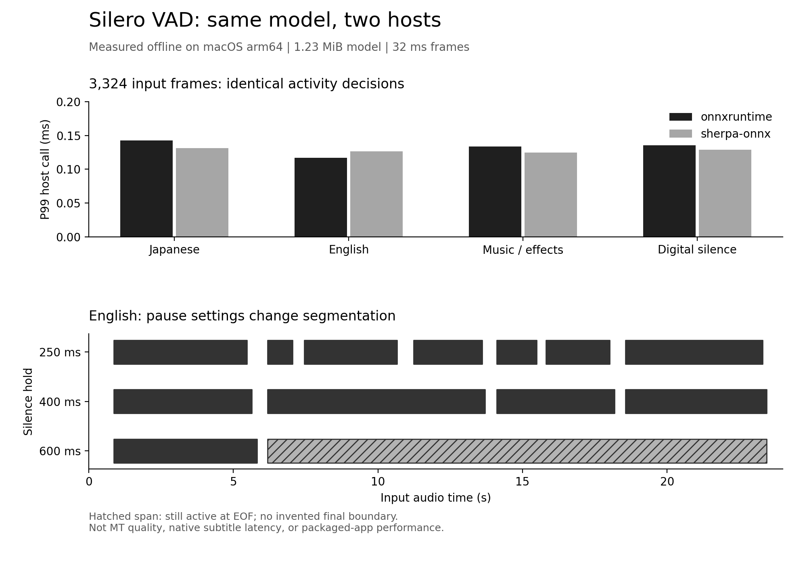

# MT 意群稳定与小型 VAD：首轮研究结果

结论：**优先研究 Silero VAD 辅助的可撤销意群预览。不能只按静音定稿。**
仅为停顿检测，可以先评估直接 ONNX 推理；如果还要统一接入本地 ASR，
sherpa-onnx 更值得一起评估。当前速度结果没有证明两种宿主谁在产品里更快。

首轮离线实验没有接入 Mimi 默认路径，也没有向安装包添加模型或运行库。
没有修改 MT 提示词、读取凭据、发送云端服务请求或启动系统音频捕获。

## 可试用接入补充

后续在同一 PR 加入共享 Rust 的 `experimental-stable-units` 实验构建。
默认构建仍保留原策略。试用采用 600 ms 完整边界稳定、2 s 可撤销候选等待，
仅重译未完成尾部；原文修正撤回旧预览，服务 final 仍整句翻译。
这部分不包含 Silero 或 ONNX 运行库，不适用于服务端直接输出译文的阿里同声。
2 s 是候选选择等待，既有请求预算和网络耗时还会增加实际显示延迟。

用户要求先准备、暂不切换当前开发版。可用下面的命令生成签名候选包，
不安装、不重启应用、不采音：

```bash
npm ci
MIMI_DEV_STABLE_UNITS=1 ./scripts/dev-app.sh --build-only
```

获准切换时使用同一环境开关运行 `./scripts/dev-app.sh`，通过正常设置
选用独立识别 + 文字 MT 配置，再由用户开始会话。现有“阿里同声”配置的
输出不用于评价此实验。分句可能损失跨句上下文，整句 final 可能改写预览；
真人音频、实际 provider 时延、屏幕回改和语义质量仍待同输入 A/B。

源码验证包括：同一组共享 fixtures 的直接 Rust / 实际 JNI、两项本地 HTTP
调度回归、默认构建完整检查，以及启用实验 feature 的共享 runtime 全套测试。
本地 HTTP 只使用合成内容和本地服务，不代表云端 MT 或原生阅读效果。

## 实际测了什么

- 产品基线：`5257f7e6d633f95d5e25cbdb5d4d2ee833e3fd6f`。
- 实验代码、策略测试和结果：`16239082`；运行方式为离线 Python，非原生 app。
- 本机：Apple M5 / macOS arm64 / Python 3.9。模型 CPU 单线程。
- Silero 权重固定至 `1e261b036686cd0017d500ee96acd1c4ba572a9d`，
  16 kHz ONNX，1,289,603 bytes（1.23 MiB）。SHA256：
  `7ed98ddbad84ccac4cd0aeb3099049280713df825c610a8ed34543318f1b2c49`。
- ONNX Runtime 1.19.2、sherpa-onnx / core 1.13.8、NumPy 2.0.2。
- 同一输入窗口：512 新样本 + 64 上下文；相同阈值与迟滞。
  sherpa 使用低层 `VadModel`，不启用保留音频段的 VAD 队列。

使用既有场景矩阵的四段输入，总长 106.3 秒：FLEURS 日语 22.86 秒、英语
23.44 秒、Sintel 音乐音效 30 秒、同长度数字静音。两段真人语音只代表这两个
片段；音乐音效的“无对白”标签仍待独立听审。数字静音是明确的零 PCM 对照。
来源、许可、PCM 哈希及 reference 状态保存在结果 JSON，媒体与正文不进入 Git。

主计时为一次全输入预热、三次独立状态复位后的测量。重复不增加独立样本数。
最后不足 512 的输入帧补零，不追加静音尾段，也不把 EOF 当结束事件。

## 结果

| 输入 | ONNX P99 / 帧 | sherpa P99 / 帧 | 活动判定差异 |
| --- | ---: | ---: | ---: |
| 日语 | 0.143 ms | 0.131 ms | 0 / 715 |
| 英语 | 0.117 ms | 0.126 ms | 0 / 733 |
| 音乐音效 | 0.134 ms | 0.125 ms | 0 / 938 |
| 数字静音 | 0.135 ms | 0.129 ms | 0 / 938 |

3,324 个不同输入帧的活动判定一致，复位后重复结果一致。这里是相同模型和
相同后处理的一致性结果，**不是 VAD 准确率，也不是翻译质量指标**。
两条负对照均未产生活动段；未独立标注真人词级语音边界，不能报告漏检率。
时长是 Python 宿主调用，包含 binding 与迟滞开销，排除 WAV I/O；不能转用为
Mimi 原生端到端延迟。初始化数字含模块导入，不能比较 app 冷启动。

停顿阈值敏感性使用同样输入，250/600 ms 两轮只看边界，执行有重叠，其计时
不用于速度结论：

| 静音等待 | 英语已确认结束点 | EOF 时尾段 | 日语已确认结束点 |
| --- | ---: | --- | ---: |
| 250 ms | 7 | 已结束 | 2 |
| 400 ms | 4 | 已结束 | 2 |
| 600 ms | 1 | 仍活动 | 1 |

600 ms 时英语第二段从检测时钟 6.176 秒持续到输入结束（23.44 秒），超过
17 秒没有新的确认结束点。如果 MT 只等这种边界，就存在长时间没有更新的
风险。反过来缩短阈值会增加切段，但这些切点是否完整意群仍未知；400 ms
在这里也只是候选配置，没有被认定为最佳值。



该图是实测数字图表，不是原生字幕截图。原始数字见
[400 ms 主计时](evidence/2026-10-13-mt-stability/vad-400ms.json)、
[250 ms](evidence/2026-10-13-mt-stability/vad-250ms.json)、
[600 ms](evidence/2026-10-13-mt-stability/vad-600ms.json)。

## 对减少抖动的具体建议

采用“完整候选 + 短暂稳定观察 + 可撤销前缀 + 有界尾部预览”。停顿是额外
触发信号，不是持久定稿的依据。原文变化涉及已保留部分时必须撤销旧预览；
权威 final 仍可以修正整段，不把早期错误锁住。

[原型](../../scripts/research/mt-unit-policy.py) 已实现候选状态机，
19 项离线测试覆盖意群后的尾部更新、日语否定尾句、中文条件句、ASR 改口、
空译文、失败、迟到响应、超时、重复句、来源隔离、clear/reset、空草稿、
长度上限以及缩写／小数。原型仅验证请求候选与边界；没有实现目标译文拼接、
跨意群上下文传递、VAD 与 ASR 时间戳对齐或原生显示，所以不能报告减少了
多少字幕回改。600 ms 稳定观察、2 秒尾部预览和 1.5 秒请求预算均为实验值。

文献提供的方向也支持分别评价准确性、等待和回改：
[Re-translation versus Streaming](https://aclanthology.org/2020.iwslt-1.27/)
比较允许有限修订的重译；
[Learning Adaptive Segmentation Policy](https://aclanthology.org/2020.emnlp-main.178/)
研究结合潜在译文选择分段。它们不是这次实验的实现或实测成绩，不能把论文
改善幅度迁移给 Mimi。标点规则也不能被称为已实现完整的语义理解。

## 自带小模型还差什么

模型本身可以很小，但推理运行库和平台适配不能忽略。本次 Python 环境的
原生二进制分别达到数十 MB，且 ONNX wheel 为 universal2、sherpa 为 arm64，
不能拿两者大小当安装包对照。应用不应附带这套 Python 环境。

生产方案还需比较统一 CPU 原生库的真实包增量、启动时间、持续 CPU / 内存、
签名与 Android ABI。若仅接 Silero，可评估直接 ONNX；若同时需要本地识别，
评估 sherpa 的统一能力。模型许可、版本与哈希要随包保留，失败时不得影响
既有识别音频输入。当前未决定新的生产依赖。

下一项真实验收是同一识别与 MT 配置、同一真人样本的 A/B：分别记录首次
可读译文、最终延迟、回改字数／次数、请求数、漏句和人工语义评价。采用字符
回改指标时必须标明分词单位，不直接冒充论文的词级 normalized erasure。
仅降低回改字数而推迟所有输出，或冻结错误译文，均不算成功。

生产逻辑进入 shared Rust 后运行直接 Rust 和实际 JNI；再用签名开发版
查看浮窗。Windows、Linux、Android 原生包和实际显示仍需各自验证。

复现命令及依赖见 [research README](../../scripts/research/README.md)。
