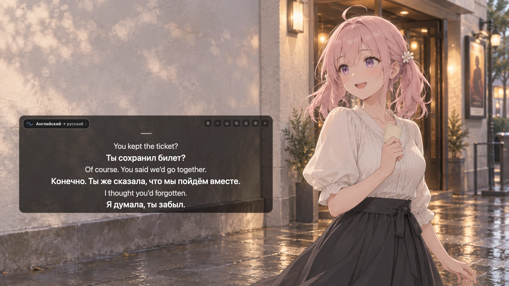

  
  <h1>Mimi</h1>
  
Субтитры с переводом в реальном времени для видео, трансляций и онлайн-занятий.

  

    
    
    
    
  

  

    
    
    
    
  

  
<a href="https://github.com/yuxino/mimi/releases/latest"><strong>Скачать Mimi</strong></a> · <a href="https://mimi.yuxino.cn/en/">Сайт</a> · <a href="../usage.ru.md">Руководство пользователя</a>

  

    <a href="../../README_EN.md">English</a> · <a href="../../README.md">简体中文</a> · <a href="zh-TW.md">繁體中文</a> · <a href="ja.md">日本語</a> · <a href="th.md">ภาษาไทย</a> · <a href="ko.md">한국어</a> · <a href="fr.md">Français</a> · <a href="de.md">Deutsch</a> · <a href="ru.md"><strong>Русский</strong></a>
  

**Субтитры с переводом в реальном времени — без ещё одной подписки.** Mimi — бесплатная альтернатива платным приложениям для субтитров в реальном времени с открытым исходным кодом. Подключите собственные сервисы распознавания речи и перевода, чтобы добавлять субтитры к видео, трансляциям и онлайн-занятиям.

<!-- mimi-preview:start -->

<!-- mimi-preview:end -->

## Возможности

- **Читайте на двух языках.** Смотрите видео, трансляции и онлайн-занятия с двуязычными субтитрами или отображайте только перевод либо оригинал.
- **Не закрывайте изображение.** Перемещайте субтитры и настраивайте размер и цвет текста. Иммерсивный режим скрывает элементы управления, а режим пропуска нажатий позволяет работать с приложением под субтитрами.
- **Выбирайте источник звука.** На компьютере можно захватывать звук одного приложения в macOS / Windows 11 или отдельного потока воспроизведения в Linux.
- **Сохраняйте на потом.** На компьютере можно включить сохранение субтитров или запись звука, а затем экспортировать субтитры в TXT / Markdown или звук в WAV. Обе функции по умолчанию отключены.

## Начало работы

Для облачных сервисов нужен собственный API-ключ; поставщик может взимать плату за использование. Захваченный звук или распознанный текст отправляется в выбранный вами сервис.

На поддерживаемых Mac с чипом Apple и macOS 26+ после загрузки необходимых языковых ресурсов также можно использовать [локальные сервисы Apple (на английском)](../provider-setup.md#apple-speech) без API-ключей.

1. **Скачайте и установите.** Выберите пакет для своей системы на [странице загрузки](https://github.com/yuxino/mimi/releases/latest): DMG для macOS 13+ (Apple silicon или Intel), EXE для Windows x64 либо AppImage / DEB для Linux x86_64. Инструкции для Android 10+ приведены в [руководстве по установке (на английском)](../../android/README.md#start).
2. **Настройте сервис.** Откройте «Настройки → Модели и сервисы», добавьте OpenAI, Gemini, xAI или другой поддерживаемый сервис, введите учётные данные и сохраните. [Руководство по настройке (на английском)](../provider-setup.md#choose) объясняет, где их получить и что вводить.
3. **Выберите звук и языки.** Откройте «Аудио и языки» и выберите язык речи и язык перевода. По умолчанию выбран звук компьютера. Выберите микрофон, чтобы переводить собственную речь, или включите оба источника.
4. **Запустите субтитры.** Включите «Субтитры в реальном времени» на странице «Субтитры», предоставьте запрошенные разрешения и начните воспроизведение видео, трансляции или другого контента с речью.

## Нужна помощь?

[Руководство пользователя](../usage.ru.md) описывает установку, разрешения, отображение и сохранение. Если субтитры не появляются, начните с раздела [«Ошибки распознавания»](../usage.ru.md#errors). Вы также можете [сообщить о проблеме](https://github.com/yuxino/mimi/issues).

Участники и сообщество

## Участники

Хотите помочь улучшить Mimi? Начните с [руководства для участников (на английском и китайском)](../../.github/CONTRIBUTING.md).

Спасибо всем, кто пишет код, сообщает о проблемах, пробует Mimi или делится им (๑•̀ㅂ•́)و✧

Особая благодарность [@yebuwudong](https://github.com/yebuwudong) за [приложение для Android](https://github.com/yuxino/mimi/pull/37) и [@LLLin000](https://github.com/LLLin000) за [анимацию субтитров](https://github.com/yuxino/mimi/pull/67) и [улучшение захвата звука в Windows](https://github.com/yuxino/mimi/pull/89).

Также спасибо [@Chtholly000](https://github.com/Chtholly000) за улучшение [непрерывных субтитров Gemini и планируемой смены подключений](https://github.com/yuxino/Mimi/pull/176).

Спасибо [@EmmetZ](https://github.com/EmmetZ) за исправление [элементов управления оверлеем Wayland](https://github.com/yuxino/Mimi/pull/242), добавление [захвата отдельных потоков воспроизведения в Linux](https://github.com/yuxino/Mimi/pull/275) и [значков приложений для потоков воспроизведения](https://github.com/yuxino/Mimi/pull/304).

Спасибо [@wangmian0](https://github.com/wangmian0) за [отключение режима размышлений при переводе субтитров в реальном времени в DeepSeek](https://github.com/yuxino/Mimi/pull/270).

Спасибо [@hubumulity](https://github.com/hubumulity) за [настройку количества отображаемых субтитров](https://github.com/yuxino/Mimi/pull/303).

Спасибо [@ryannyui](https://github.com/ryannyui) за [исправления графической совместимости Linux AppImage и обновление инструментария сборки](https://github.com/yuxino/Mimi/pull/312).

  
  
  
  
  
  
  
  
  

[Все участники](https://github.com/yuxino/mimi/graphs/contributors)

## Сообщество

Спасибо участникам [V2EX](https://www.v2ex.com/), [LINUX DO](https://linux.do/), [Appinn](https://meta.appinn.net/), [NodeLoc](https://www.nodeloc.com/), [Solo](https://solo.xin/), [Xinquji](https://xinquji.com/posts/859305) и [Eleduck](https://eleduck.com/) за то, что пробуют Mimi, делятся отзывами и рассказывают о нём.

[MIT](../../LICENSE) © 2026 yuxino
